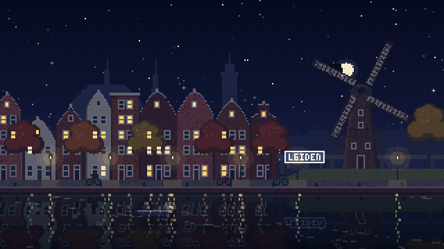
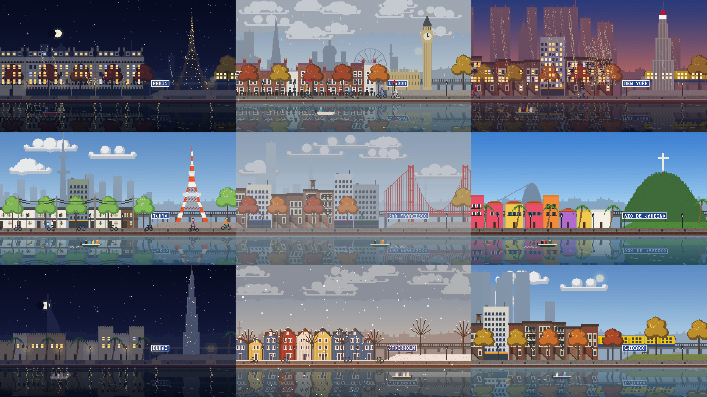
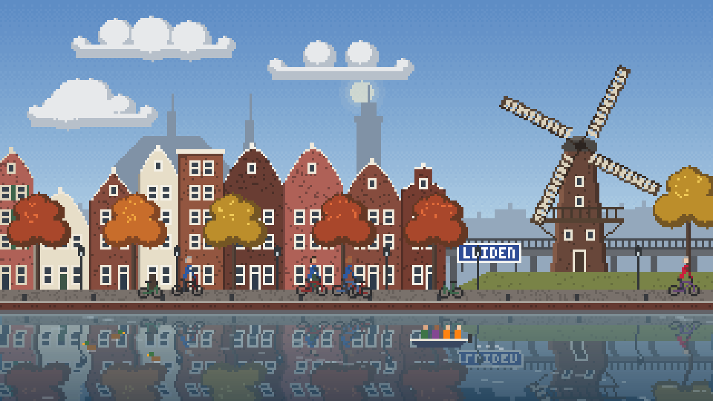
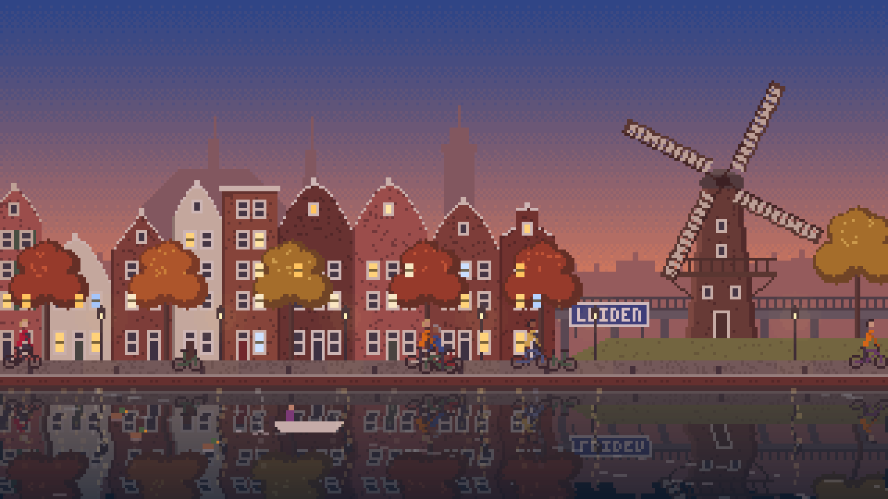
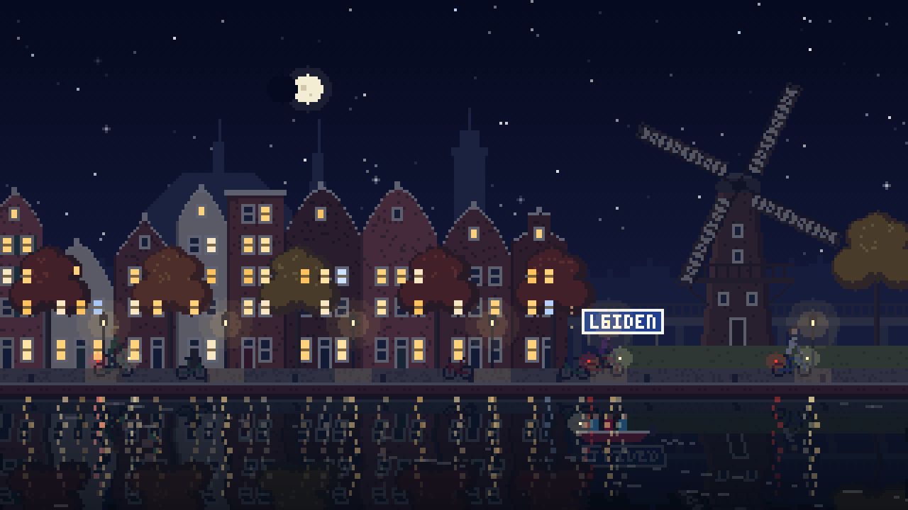
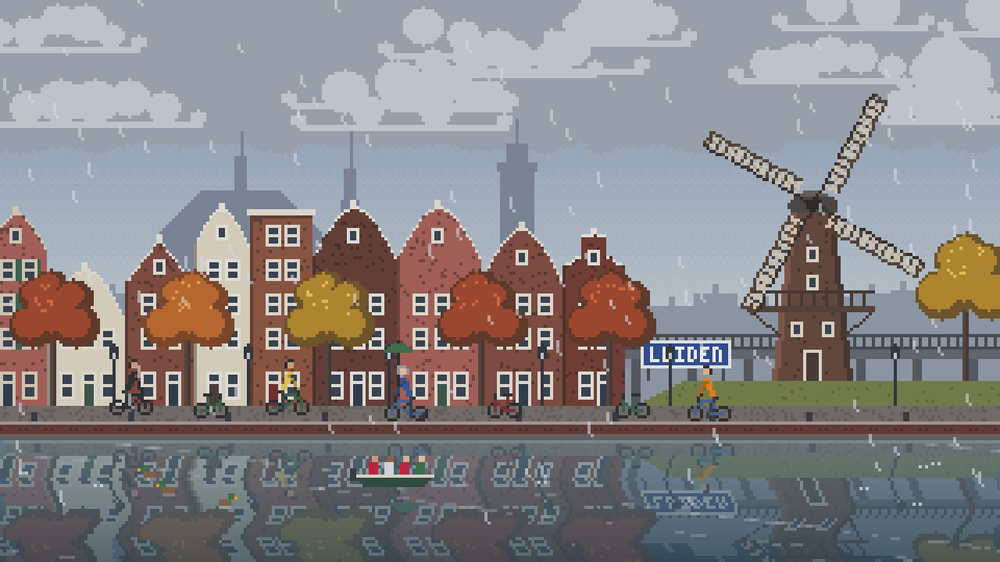
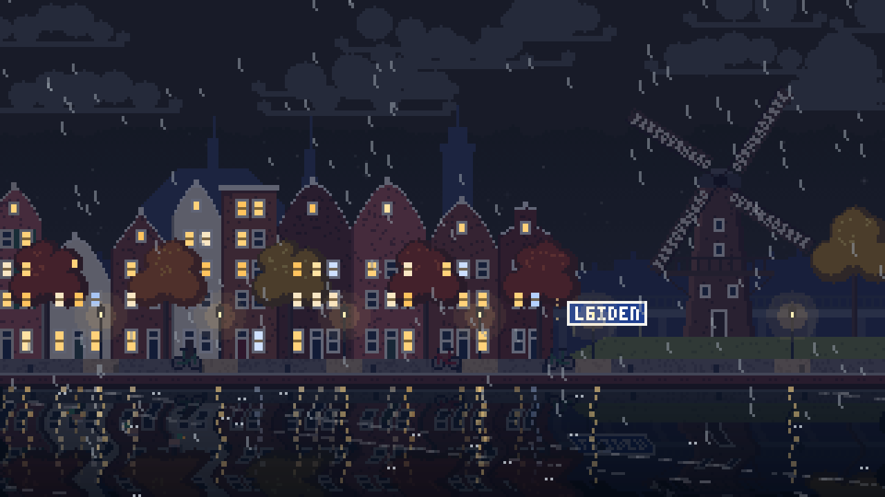
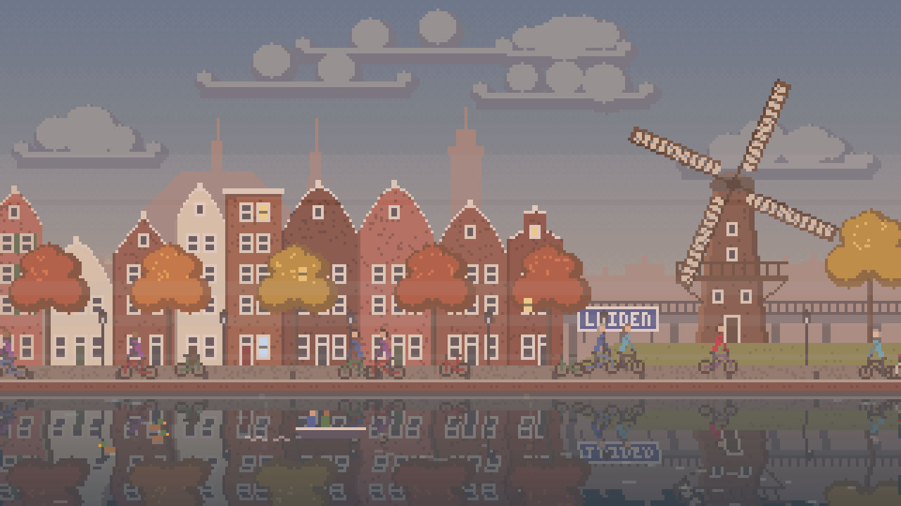
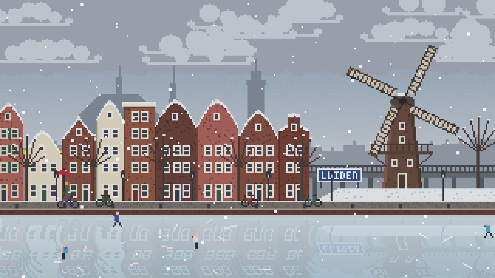
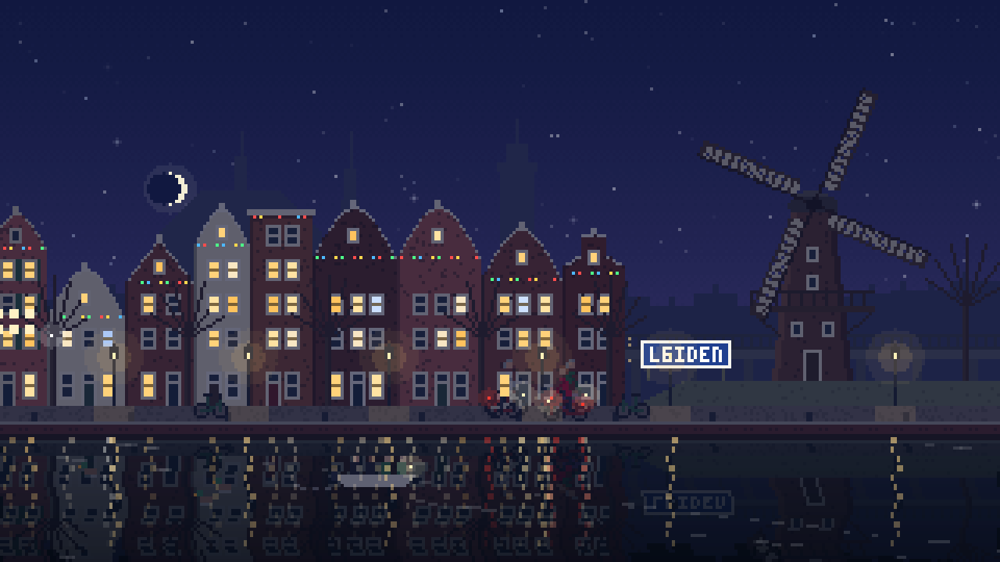

<div align="center">



# pixel-window

**A live pixel-art view of your own city as your desktop wallpaper.**<br>
It finds where you are, draws your city so you'd recognize it, and follows the real time and weather outside.

### [▶ Open the live demo](https://bladerc.github.io/pixel-window/)

[Your city](https://bladerc.github.io/pixel-window/) · [Paris at night](https://bladerc.github.io/pixel-window/?city=Paris&time=2026-10-22T21:02&weather=clear) · [Tokyo in spring](https://bladerc.github.io/pixel-window/?city=Tokyo&season=spring) · [A storm in London](https://bladerc.github.io/pixel-window/?city=London&weather=storm) · [A day in 60 seconds](https://bladerc.github.io/pixel-window/?speed=1440)

</div>

When it rains where you are, it rains on your desktop. The sun rises and sets at your real times, the moon shows its real phase, windows light up as evening falls, and the wind turns the windmills and bends the trees. Cyclists ride past (with umbrellas in the rain), a train crosses the viaduct, boats drift by, and in a real cold snap the canal freezes over and the skaters come out.



## Your city, recognizable

pixel-window finds your city from your internet connection, or you type one in. Then it builds the view in three layers:

1. **Hand-drawn landmarks** for 17 cities:
   - **Leiden:** De Valk.
   - **Amsterdam:** the Westerkerk.
   - **Paris:** the Eiffel Tower, which sparkles for the first five minutes of every hour after dark.
   - **London:** Big Ben and Westminster.
   - **New York:** the Empire State Building.
   - **Tokyo:** Tokyo Tower.
   - **Rome:** the Colosseum.
   - **Berlin:** the Fernsehturm.
   - **Barcelona:** the Sagrada Família, crane included.
   - **Sydney:** the Opera House.
   - **Dubai:** Burj Khalifa.
   - **San Francisco:** the Golden Gate Bridge.
   - **Istanbul:** a mosque with four minarets.
   - **Seattle:** the Space Needle.
   - **Toronto:** the CN Tower.
   - **Rio:** Cristo Redentor.
   - **Chișinău:** Cathedral Park, with the Triumphal Arch, the Nativity Cathedral and its bell tower.

   Each city also gets smaller icons on its horizon, like the Shard, the London Eye and the Skytree.
2. **Local building styles everywhere**: Dutch gables, Paris mansards with iron balconies, London brick terraces with chimney pots, New York brownstones with stoops and fire escapes, whitewashed Mediterranean houses, colourful Latin American houses, desert flat roofs, painted Nordic wooden houses, Central European half-timbering, Japanese houses with tiled eaves and utility poles, and Eastern European streets of Soviet-era panel blocks (every balcony glazed differently), pastel houses with tin roofs and Orthodox churches with onion domes. Palm trees grow where they should.
3. **The real skyline of any city**: the tall buildings, towers and churches within 6 km, with their real heights from [Wikidata](https://www.wikidata.org/). They're placed in true perspective, and at night they get lit windows and blinking aircraft lights. That way Rotterdam, Chicago or Frankfurt look like themselves, even without a hand-drawn pack.

A station sign shows the city's name. Seasons flip in the southern hemisphere and stay summery in the tropics. Window lights follow the city's own time zone.

| | | |
|---|---|---|
|  |  |  |
|  |  |  |
|  |  | |

## What's alive in it

- **Real sun and moon**, computed from the sun's actual position (NOAA formulas): dawn, golden hour, sunset, dusk, stars, the moon's real phase.
- **Real weather** from [Open-Meteo](https://open-meteo.com/), refreshed every 15 minutes: clear, clouds, overcast, fog, drizzle, rain, thunderstorms with lightning, snow. The wind drives the windmill, the clouds, the trees and the rain.
- **A town that keeps its own hours**: rush-hour cyclists (many in the Netherlands, fewer elsewhere), quiet nights, windows lighting up after sunset and going dark after midnight, trains that stop at night.
- **Seasons and days**: autumn leaves blowing off the trees, bare branches and snowy roofs in winter, a frozen canal after three nights of real frost, orange flags on King's Day in the Netherlands, Leidens Ontzet on 3 October, and Christmas lights in December.
- **Light on your PC**: it runs at 12 frames per second, takes 2–4 ms a frame, and Lively pauses it while a game or another fullscreen app is open.

## Use it as your wallpaper (Windows)

1. Install [Lively Wallpaper](https://www.rocksdanister.com/lively/), which is free and open source:

   ```powershell
   winget install rocksdanister.LivelyWallpaper
   ```

2. In Lively, click **+ Add wallpaper** and paste `https://bladerc.github.io/pixel-window/`.

   Or, to run it offline from your own copy: download this repository (Code → Download ZIP), unzip it, and choose the folder's `index.html`.
3. Optional: add `?city=Paris` (or any city) to the URL. Or, with the downloaded copy, type a **City** in the wallpaper's settings. Leave it out and your city is detected automatically.

**On a Mac**, the free app [Plash](https://sindresorhus.com/plash) shows any web page as your wallpaper: give it the same URL.

## Privacy

Everything runs on your PC; there are no accounts and no tracking. To work, it talks to three free services:
- [GeoJS](https://www.geojs.io/) finds your city from your IP address. This only happens when you haven't typed a city.
- [Open-Meteo](https://open-meteo.com/) handles the weather, plus the city search when you type a name.
- [Wikidata](https://www.wikidata.org/) provides the skyline, once per city, cached for 30 days.

They only ever receive your city's coordinates or the name you typed.

## Try it in a browser

Serve the folder (`python -m http.server`) and open it. These URL options are handy for screenshots and videos:

| Option | What it does |
|---|---|
| `?city=Tokyo` | Any city by name |
| `?lat=51.92&lon=4.48&name=Rotterdam&country=NL` | An exact spot |
| `?time=2026-10-22T19:30` | Pretend it's that local time in the city |
| `?speed=600` | Time-lapse: 600× faster |
| `?weather=rain` | `clear`, `clouds`, `overcast`, `fog`, `drizzle`, `rain`, `heavyrain`, `storm`, `snow`, `blizzard` |
| `?wind=40` | Wind in km/h |
| `?frozen` | Freeze the canal |
| `?season=winter` | `spring`, `summer`, `autumn`, `winter` |
| `?event=december` | `kingsday`, `ontzet`, `december` |
| `?debug` | Show the place, style, sun height, weather and frame cost |

## How it's built

Plain JavaScript drawing on a 320×180 canvas (wider on wide screens), scaled up with crisp pixels. There's no build step and no dependencies.

| File | What's in it |
|---|---|
| `src/location.js` | Your city: typed name or IP location, time zones |
| `src/cities.js` | The 17 landmark cities and each country's building style |
| `src/styles.js` | The regional house styles |
| `src/landmarks.js` | Hand-drawn landmarks and skyline icons |
| `src/skyline.js` | Real skylines from Wikidata, in perspective |
| `src/sun.js` | Sun position, sunrise and sunset, moon phase |
| `src/weather.js` | Open-Meteo request and weather codes → scene |
| `src/palette.js` | Sky and light colours by sun height and weather |
| `src/scene.js` | Lays out the town: houses, trees, quay, viaduct, sign |
| `src/actors.js` | Cyclists, train, boats, ducks, skaters, gulls |
| `src/effects.js` | Sky, clouds, water, rain, snow, fog, lightning, lights |
| `src/font.js` | The pixel font of the station sign |
| `src/main.js` | The loop, the layers, and the URL and Lively options |

Run the tests with `node --test "test/*.test.js"`. Regenerate the screenshots and GIF with `python tools/shots.py` while the folder is being served.

## License

MIT
